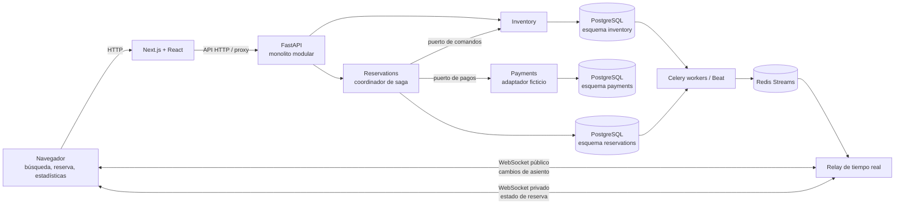
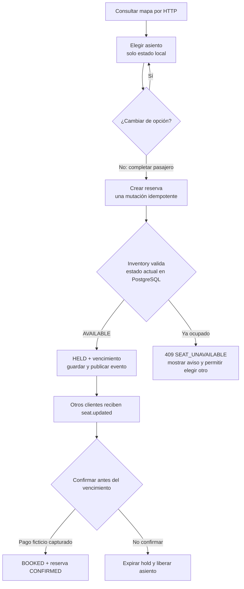
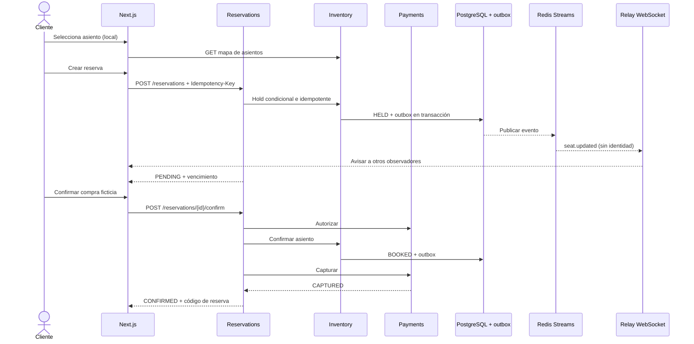
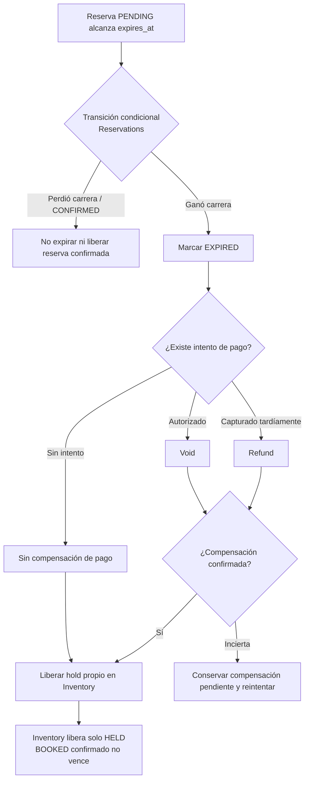

# Arquitectura y flujos

## Vista de componentes



## Decisiones técnicas

- **Monolito modular** con backend FastAPI y frontend Next.js separado: facilita
  ejecutar el prototipo localmente, manteniendo límites para Inventory,
  Reservations y Payments sin el costo operativo de microservicios.
- **DDD ligero y arquitectura hexagonal:** los casos de uso dependen de puertos;
  FastAPI, SQLAlchemy/PostgreSQL, Celery, Redis y WebSockets son adaptadores.
- **Propiedad de datos:** cada módulo administra sus tablas dentro de su propio
  esquema PostgreSQL. No se hacen escrituras cruzadas; la colaboración usa
  puertos y contratos.
- **Inventory** posee vuelos, asientos y sus transiciones; **Reservations**
  coordina el ciclo de la reserva y la saga; **Payments** registra intentos
  ficticios. El tablero es una vista de lectura de Inventory, no un módulo de
  dominio.
- **Outbox + Redis Streams:** los eventos se publican después de persistir el
  cambio. La entrega puede repetirse; los consumidores deduplican. Celery
  programa la expiración y el despacho, no es el transporte de eventos.
- **Pagos:** no se recopilan datos de tarjeta ni se integra una pasarela. Una
  reserva solo queda confirmada tras capturar el intento ficticio.

## Selección local y bloqueo atómico

Al hacer clic en una plaza disponible, el frontend cambia únicamente su
selección local. Ese clic no es todavía una intención confirmada de reservar.
El hold se solicita una sola vez cuando el usuario completa sus datos y pulsa
**Crear reserva**.

La decisión evita enviar una mutación por cada clic y las operaciones
compensatorias de reservar/cancelar que produciría una selección exploratoria
(por ejemplo, recorrer muchas plazas). También reduce escrituras, eventos,
tráfico y trabajo de reconciliación. Una reserva prematura podría mantener
plazas ocupadas mientras el usuario solo compara opciones. Además, el canal
público no revela quién bloqueó una plaza: por privacidad informa el estado,
no la identidad del pasajero.

El costo de esta decisión es que la selección visual no garantiza disponibilidad.
Otro cliente puede obtener el hold antes. Al crear la reserva, Inventory vuelve
a validar la plaza en una transición transaccional; solo un cliente gana y el
otro recibe `SEAT_UNAVAILABLE` para elegir otra. La disponibilidad del mapa es
una instantánea, no una promesa.



## Reserva, eventos y compensación



La confirmación solo se anuncia como completa después de `CAPTURED`. Si falla la
captura tras marcar el asiento `BOOKED`, Reservations intenta compensar el pago
y liberar la asignación; mantiene la compensación pendiente mientras el resultado
sea incierto.



Inventory usa bloqueo transaccional y una actualización condicionada por el
estado vigente. Solo expira `HELD`; `BOOKED` no se libera por el worker. La
confirmación concurrente y la expiración compiten mediante transiciones
condicionales/versionadas, así no pueden ganar ambas.

## Contratos y canales

- Búsqueda y mapa: `GET /api/v1/inventory/flights` y
  `GET /api/v1/inventory/flights/{flightId}/seats`.
- Crear reserva: `POST /api/v1/reservations`; el servidor obtiene precio y TTL,
  y solicita el hold. Las mutaciones internas de Inventory no son llamadas
  directas del navegador.
- Confirmación y consulta privada: `POST`/`GET
  /api/v1/reservations/{reservationId}` con credencial bearer de alcance
  limitado a esa reserva. La credencial no va en URL ni en logs.
- WebSocket público de asientos difunde vuelo, asiento y estado, sin datos de
  pasajero o reserva. WebSocket privado solo notifica la reserva autorizada.
  HTTP vuelve a sincronizar el estado después de una desconexión.

## Estadísticas en tiempo real

`/estadisticas` consulta una instantánea del mapa de Inventory y escucha
`seat.updated` para cada vuelo mostrado. Recalcula los contadores sin recargar;
si se pierde el WebSocket, se resincroniza por HTTP.

| Acción | Cambio en Inventory | Cambio en el tablero |
| --- | --- | --- |
| Seleccionar un asiento | Ninguno: selección local | Sin cambios |
| Crear reserva | `AVAILABLE → HELD` | −1 disponible, +1 bloqueado |
| Pasar el asiento a ocupado durante la confirmación | `HELD → BOOKED` | −1 bloqueado, +1 en «Confirmados» |
| Vencer un bloqueo sin confirmar y liberar el asiento | `HELD → AVAILABLE` | −1 bloqueado, +1 disponible |

El indicador «Confirmados» refleja `BOOKED` en Inventory, no una consulta al
estado de pago. La reserva solo se muestra como confirmada al comprador tras
la captura. El porcentaje se calcula sobre las plazas habilitadas: las que
están fuera de servicio no cuentan en el denominador.

## Observabilidad

La API y los módulos emiten eventos de aplicación como una línea JSON por
evento. Las peticiones HTTP y las sesiones WebSocket incluyen la plantilla
de ruta, estado o código de cierre y duración. Inventory registra el resultado
de sus comandos de asiento; Reservations, las transiciones de saga, expiración
y compensación; Payments, el resultado de cada operación ficticia. Los workers
registran lotes con actividad y errores; también se registra el paso de eventos
por el outbox y el relay.

`request_id` identifica una petición, conexión o ejecución de worker y se
devuelve como `X-Request-ID` en las respuestas HTTP de la aplicación.
`correlation_id` enlaza los eventos de una reserva entre módulos y procesos;
cuando no hay una reserva asociada se usa el identificador de ejecución.
`entry_point` distingue HTTP, WebSocket, worker y consumo del stream.

Los eventos no incluyen URLs con datos del cliente, cabeceras, cuerpos,
credenciales, datos personales, detalles de pago ni mensajes de excepciones.
Los logs de infraestructura de Uvicorn/Celery siguen siendo independientes.

Ejemplo ficticio de una captura, formateado para lectura (se emite en una línea):

```json
{
  "timestamp": "2026-11-19T18:15:02.371+00:00",
  "level": "INFO",
  "module": "payments",
  "event": "payment_operation",
  "entry_point": "http",
  "request_id": "c3d0bef7fd08440d9e16ff7eec43ffd1",
  "correlation_id": "65af03920dea494da147b369cb979cc6",
  "operation": "capture",
  "outcome": "CAPTURED"
}
```

## Pruebas y alcance

`make check` aplica lint, tipos, pruebas y un umbral mínimo de **80 % de
cobertura de líneas por proyecto**. Verificación registrada: frontend Jest,
35 pruebas/14 suites y 81,04 % de líneas; backend pytest, 62 aprobadas/4
integraciones optativas omitidas y 82,31 %. PostgreSQL/Redis optativos verifican
concurrencia real; SQLite no se usa como prueba de locking.

Implementado: búsqueda por origen/destino/fecha, mapa, bloqueo temporal al crear
reserva, notificación a otros observadores, pago ficticio, código de reserva y
tablero de ocupación en vivo.

Límites frente al enunciado:

1. El enunciado pide iniciar el hold al seleccionar el asiento; aquí se inicia
   al pulsar **Crear reserva**, por las razones descritas arriba.
2. Los resultados de búsqueda no reciben eventos de cambios de estado del vuelo;
   una cancelación o demora se ve al volver a consultar.
3. El prototipo es local/no público, no tiene autenticación de usuario ni pagos
   reales. El relay de demo es de una instancia; recuperación tras reinicio,
   DLQ/replay operativos y lector de pantalla quedan fuera de la verificación.
